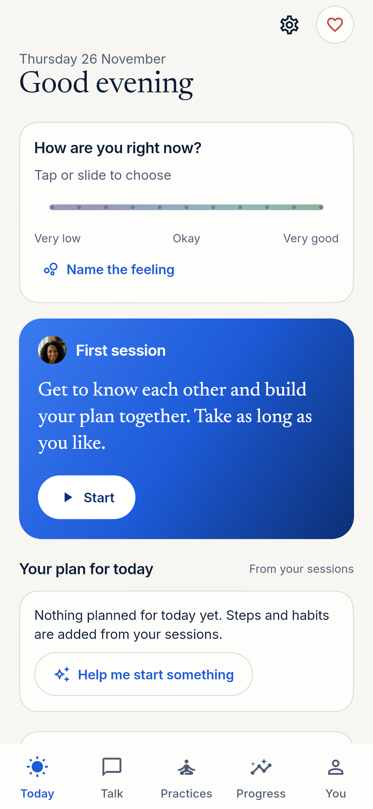
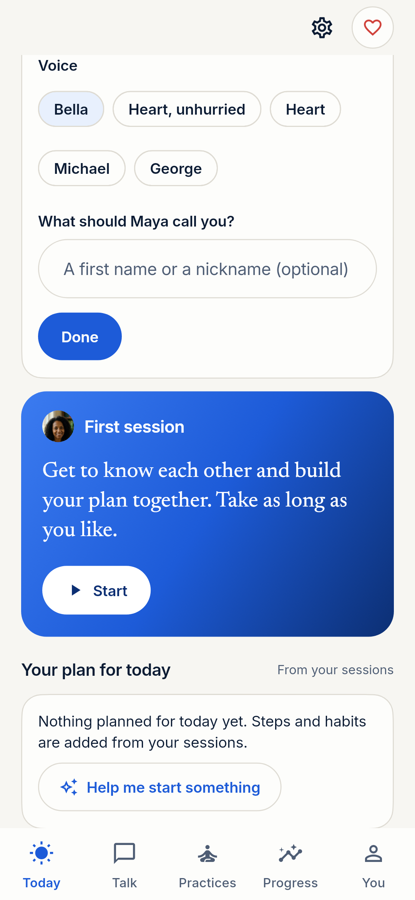
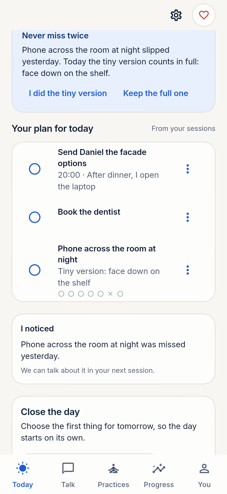
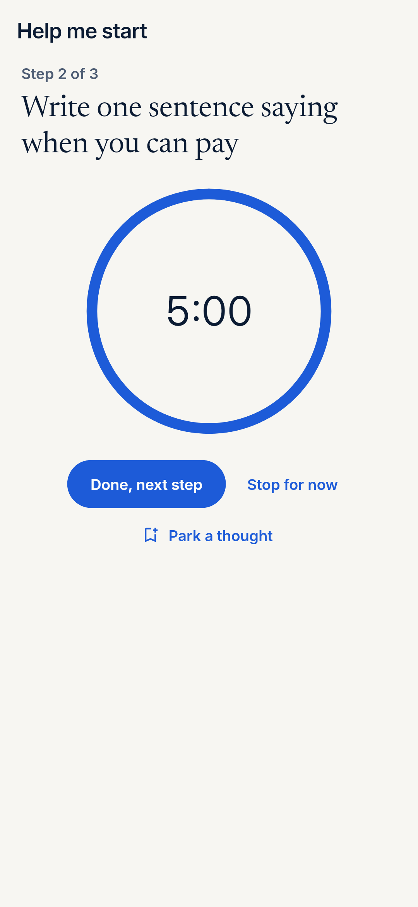
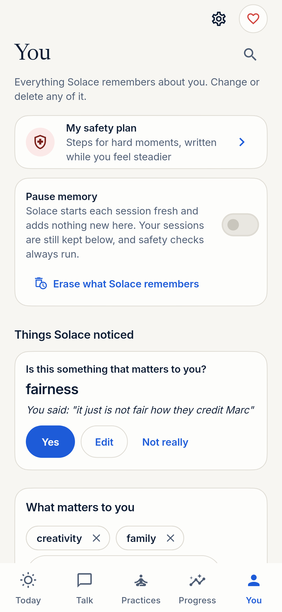
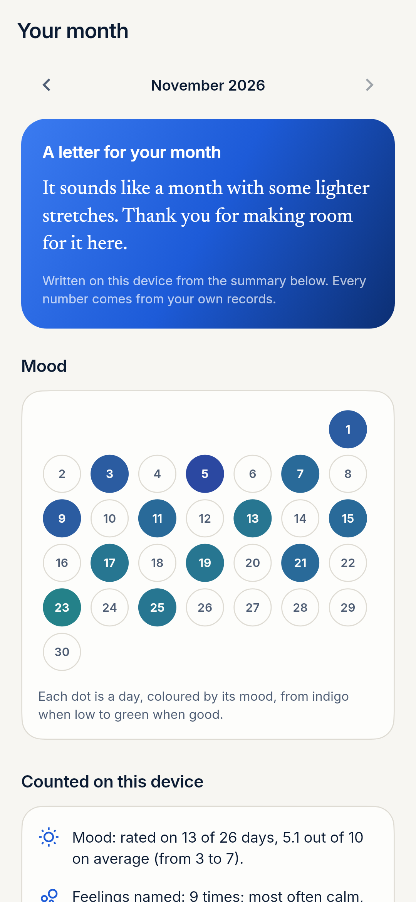
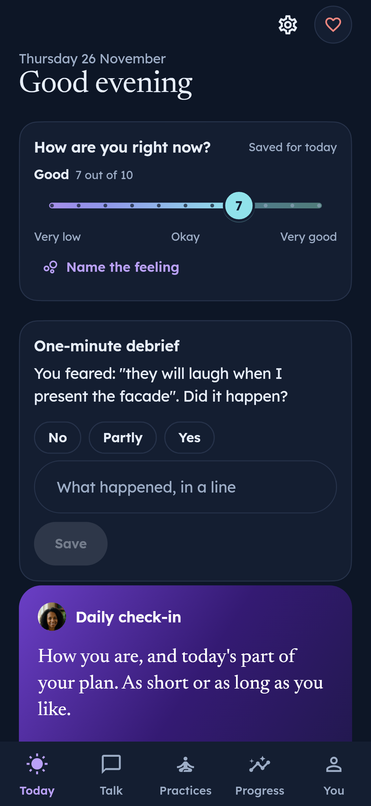
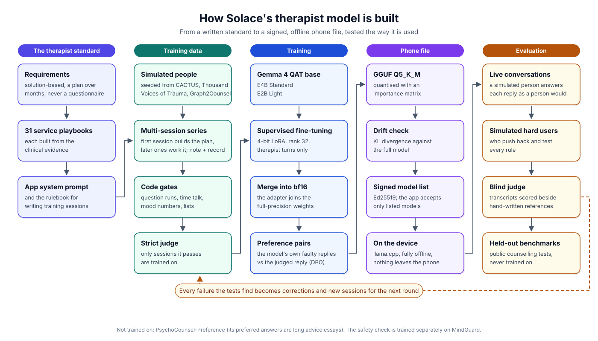

# Solace

> **Work in progress.** This repository is a display copy of an ongoing project, shared for review. It is not ready to
> build, install or use, and parts of the project are deliberately left out (see "What this copy leaves out").

**A private AI therapist and coach that runs entirely on the person's own device.**

Solace talks with a person by text or voice. In the first session it builds a plan with them; in every later session
it works through that plan, for weeks or months if needed, using methods research shows work: CBT, behavioural
activation, exposure and response prevention, CBT for insomnia, problem solving, DBT skills, ACT, self-compassion,
motivational interviewing and habit design. It remembers every session through its own notes and a therapy record the
person can read and edit.

The therapist model is a fine-tuned **Gemma 4** (E4B "Standard" and E2B "Light"), run on the device by llama.cpp.
Nothing the person says leaves the device.

  
  
  

> Solace is not a medical device, a licensed clinician or an emergency service. It does not diagnose or prescribe.

## Why it exists

Traditional therapy is often slow and passive: weeks of listening, exploring and questions, and few concrete tools to
actually solve the problem. Solace is built to be the opposite. It is **solution-based**: when someone brings a
problem, the therapist names the research-backed method that fits (CBT, behavioural activation, exposure and response
prevention, CBT for insomnia, problem solving, DBT skills, ACT, self-compassion, motivational interviewing, habit
design), explains plainly why it works, shows step by step how to do it in their life, and does the work with them in
the session. It asks a question only when it truly needs the answer, builds a plan with the person in the first
session, and keeps working through that plan with them over weeks or months.

Solace supports people with everyday mental-health problems; it does not replace clinical care, diagnosis or
emergency help.

## What the work involved

- **The therapist standard.** A written standard for the therapist (solution-based, plan-driven, warm, never a
  questionnaire, never just a sounding board), turned into the app's system prompt (`prompts/app_system_v5.txt`), a
  rulebook for writing training sessions (`prompts/v5/`), and 31 expert playbooks, one per service, each grounded in
  the published evidence (`prompts/services/`, sources in `docs/SERVICE_SOURCES.md`).
- **Training data and training.** Multi-session therapy series, judged strictly, then fine-tuning and export to
  small phone files; see "Training data and architecture" below.
- **Evaluation that adapts.** Live conversations in which a simulated person answers each reply as a real person
  would, simulated hard users, and blind judging of transcripts against hand-written reference sessions. Fixed
  scripts of user messages were rejected as a test, because they stop making sense after the first few turns.
- **The app.** A Flutter app for iPhone, Android, Mac and Linux: the therapist, voice calls, encrypted memory, the
  plan view, the check-in, practices, and an encrypted transfer between the person's own devices (`app/`).
- **Privacy by design.** The standard build has no network code or network permission at all, and tests enforce it.
  An optional separate build can use the model on the person's own computer, only over their home network or a
  private VPN, never the open internet (`home_server/`).

## What makes Solace different, in screenshots

From the app's screenshot tests; all people and data in them are fictional.

| | |
|---|---|
|  | **A voice call with a therapist that runs on the phone itself.** Speech recognition, the therapist model and its voice all run on the device, so a person can talk out loud, at any hour, with nothing leaving the phone. |
|  | **A named therapist who builds a plan with you.** The person chooses a face and a voice and says what the therapist should call them; the first session is for getting to know each other and building the plan together, with no time limit. |
|  | **The plan turns into today's steps.** Steps and habits agreed in sessions appear on Today. When one slips, Solace offers a smaller version that still counts ("never miss twice") and brings it to the next session instead of letting it quietly drop. |
|  | **Help me start.** For the moment a person is stuck, a task is broken into a few small, timed steps, one at a time, with a place to park a distracting thought. |
|  | **Memory the person controls.** Everything Solace remembers is in one place to read, change or delete; memory can be paused; and something the app noticed (a value, a goal) is kept only after the person says yes. |
|  | **Patterns worked out on the device, honestly.** Solace points out what tends to go together in the person's own records, with how many days it rests on, and says plainly that a pattern is worth noticing, not proof. |
|  | **A letter for the month.** Written on the device from the month's summary; every number in it comes from the person's own records. |
|  | **The records belong to the person.** Everything inside Solace is encrypted with a key only the device holds. When the person chooses, they can make a summary for their GP, counsellor or psychologist, with standard questionnaires and only the notes they tick. |

The same app on a computer, a tablet and in a dark theme:

  
  
  

## Training data and architecture

**The training sessions.** The model learns from multi-session therapy series between simulated people and the
therapist: a first session that builds the plan, then check-ins and weekly sessions weeks or months in, each followed
by the note and the therapy record the app asks the model to write. The series are written to the rulebook, partly by
open models and, for the gold standard, by hand in Claude Code sessions; every session then passes code gates (no runs
of questions, no time limits, no mood numbers, spoken sentences) and a strict judge, and only passed sessions are
trained on. The current round trains on 145 judged sessions (867 rows with their notes and records).

**Public datasets that shaped it.**
- **CACTUS** (31,577 CBT counselling dialogues with intake forms): seeds for realistic simulated people and their
  intake histories, and everyday lines for checking the safety check does not raise false alarms.
- **Thousand Voices of Trauma** (3,000 prolonged-exposure therapy conversations): seeds for people with trauma
  histories and the shape of exposure work.
- **Graph2Counsel**: counselling knowledge graphs used as extra seeds for people.
- **MindGuard** (Sword Health): the training set of the optional safety check, relabelled message by message.
- **CounselingBench, CBT-Bench and CounselBench-Adv** (with expert labels): held-out evaluation only, never trained on.
- **PsychoCounsel-Preference** (36,653 preference pairs): studied and deliberately *not* trained on, because its
  preferred answers are long written advice essays, the opposite of a spoken, solution-based therapist.
- Each of the 31 services also has an expert playbook built from the clinical literature (`docs/SERVICE_SOURCES.md`).

**The training architecture.**

  

## Current state (November 2026)

### Done
- **The app** (release 1.4.0, built privately) for iPhone, Android, Mac and Linux: text sessions and voice calls with
  the therapist, the first session that builds a plan and the plan view in every session, the therapist's name and
  personality, the check-in before a session, practices, Help me start, insights and the monthly letter, memory the
  person can read, edit, pause and erase, encryption at rest behind the app's own passcode, and the encrypted
  transfer between the person's own devices.
- **Privacy:** the standard builds contain no network code and no network permission, enforced by tests on every
  build.
- **The models:** Gemma 4 E4B (Standard) and E2B (Light), fine-tuned on judged sessions written to the therapist
  standard, exported as small phone files and checked for drift against the full models. Model files are verified
  against a signed list, so a better model can be added later without a new version of the app.
- **Evaluation:** live conversations with a simulated person who answers each reply, simulated hard users, and blind
  judging against hand-written reference sessions.
- **The call screen on Intel Macs:** its visual glitches are fixed (the app now draws with a different renderer),
  confirmed on a real device.
- **Solace Home (first version):** a separate build and a small home server for Mac and Linux, so a phone with too
  little memory can use the model on the person's own computer, paired with a one-time code over the home network or
  a private VPN only.

### In progress
- **Two further training rounds** after 1.4.0: one on more judged sessions aimed at the failures the tests found, and
  one on corrections of the model's own mistakes. In the hard-user test the Standard model improved (table below);
  it still has to pass live conversations read by a blind judge before it replaces the 1.4.0 model.
- **Preference training** (DPO) on the model's own faulty replies has so far made no measurable difference in three
  attempts, so the gains come from better supervised data.

| | Replies ending in a question (median) | Judge score, 1 to 5 |
|---|---|---|
| The first shipped model | 99% | 2.5 |
| Release 1.4.0, Standard | 40% | 4.2 |
| Current training round, Standard | 30% | 4.6 |
| Hand-written reference sessions | about 27% | |

Each number comes from a single test run of 16 conversations, so it is a signal, not a stable result. The current
round was trained on sessions written to fix the failures these scenarios expose, so part of its gain may not carry
over to new situations.

### Open issues
- **Solace Home does not work end to end yet.** In 1.4.0 the phone pairs with the home server, but when the person
  talks to or calls the therapist, the phone does not yet recognise the replies the server sends back, so the
  conversation cannot go through the home server.
- **The Light model is weaker than Standard:** it still ends too many replies with a question, sometimes hands the
  work back to the person, and can agree with a belief it should gently challenge.
- **Plans and urgent problems:** the Standard model sometimes gives a plan's length only when asked, and can put an
  urgent practical problem off to a later phase.
- **The record after a session** can state something that did not happen (for example a number the person never
  gave); the person can read and correct it.
- **Questions:** both models still end more replies with a question than the hand-written standard.
- **Voice:** a more natural therapist voice is wanted.
- **Small phones** (3 to 4 GB of memory) cannot hold even the Light model; Solace Home is meant for them, once it
  works end to end.
- **iPhone builds** are not yet signed for distribution.

## What is in this copy

| Folder | What it holds |
|---|---|
| `app/` | The Flutter app's source (part of it) |
| `home_server/` | The optional home gateway's source (part of it) |
| `prompts/` | The app's system prompts, the writing rulebook, the 31 service playbooks and the judges |
| `pipeline/` | Parts of the training-data pipeline |
| `train/` | Parts of the training code |
| `tests/` | Evaluation probes and the people they use (all fictional) |
| `docs/` | The services and their sources, research on what makes a good therapist, the design of the practices, a sample of model sessions read for a clinician, and design prototypes |

## What this copy leaves out

Build and release tooling, the training and test infrastructure, operational guides, internal reviews and logs,
trained model files and datasets, and any file that held details of the machines and accounts the project runs on.
Some source files are missing for the same reason, so the code here does not build. The full project is kept
privately.

## Who built it

**Calister Nnona** (Calyie) started Solace and leads it: the idea, the functional and non-functional requirements, the services, its privacy rules and security design, and testing it as a real user.

**Claude** (Anthropic), working in Claude Code under Calister's direction, wrote most of the code, the training
pipeline and the training sessions, ran the training and the evaluations, and wrote the documentation.

**Built on** Gemma 4 (Google), llama.cpp, Flutter, sherpa-onnx with Kokoro voices, ONNX Runtime and Unsloth, and the
open counselling datasets and clinical sources credited in `docs/SERVICE_SOURCES.md`.

## Licence

Copyright Calister Nnona. Not licensed for reuse yet. This copy is shared for review only; all rights reserved.
