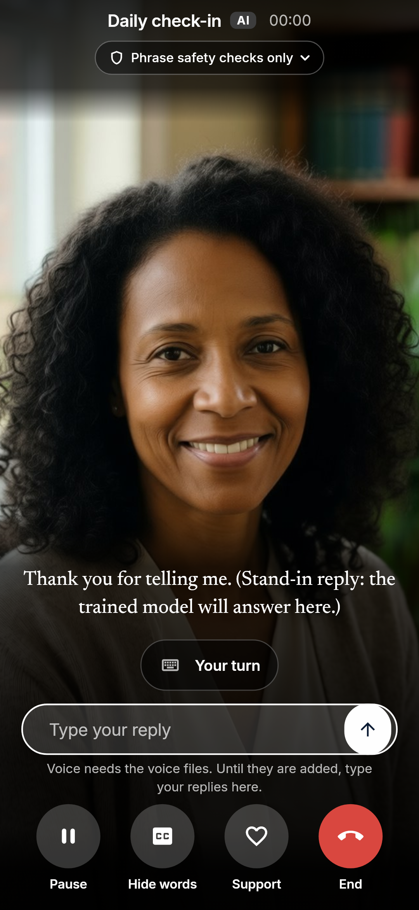

# Solace

> **Work in progress.** This repository is a display copy of an ongoing project, shared for review. It is not ready to
> build, install or use, and parts of the project are deliberately left out (see "What this copy leaves out").

**A private AI therapist and coach that runs entirely on the person's own device.**

Solace talks with a person by text or voice. In the first session it builds a plan with them; in every later session
it works through that plan, for weeks or months if needed, using methods research shows work: CBT, behavioural
activation, exposure and response prevention, CBT for insomnia, problem solving, DBT skills, ACT, self-compassion,
motivational interviewing and habit design. It remembers every session through its own notes and a therapy record the
person can read and edit.

The therapist model is a fine-tuned **Gemma 4** (E4B "Standard" and E2B "Light"), run on the device by llama.cpp.
Nothing the person says leaves the device.

  
  
  

> Solace is not a medical device, a licensed clinician or an emergency service. It does not diagnose or prescribe.

## Why it exists

Many people who try therapy find it slow and passive: a lot of listening, few concrete tools, and no clear plan. Solace
is built around the opposite idea. When someone brings a problem, the therapist names the method that fits, explains
why it works, and shows exactly how to do it in their life. It asks a question only when it needs the answer, it does
not simply agree when the person is wrong, and the person, never the therapist, decides when a session ends.

## What the work involved

- **The therapist standard.** A written standard for the therapist (solution-based, plan-driven, warm, never a
  questionnaire, never a sounding board), turned into the app's system prompt (`prompts/app_system_v5.txt`), a
  rulebook for writing training sessions (`prompts/v5/`), and 31 expert playbooks, one per service, each grounded in
  the published evidence (`prompts/services/`, sources in `docs/SERVICE_SOURCES.md`).
- **Training data.** Multi-session therapy series between simulated people and the therapist, written to the
  rulebook, checked by code gates and strict judges; only sessions a strict judge passed are trained on.
- **Training.** Supervised fine-tuning of both models with LoRA, preference training experiments, and export to small
  phone files with an importance matrix, each checked for drift against the full model (`train/`).
- **Evaluation that adapts.** Live conversations in which a simulated person answers each reply as a real person
  would, simulated hard users, and blind judging of transcripts against hand-written reference sessions. Fixed
  scripts of user messages were rejected as a test, because they stop making sense after the first few turns.
- **The app.** A Flutter app for iPhone, Android, Mac and Linux: the therapist, voice calls, encrypted memory, the
  plan view, the check-in, practices, and an encrypted transfer between the person's own devices (`app/`).
- **Privacy by design.** The standard build has no network code or network permission at all, and tests enforce it.
  An optional separate build can use the model on the person's own computer, only over their home network or a
  private VPN, never the open internet (`home_server/`).

## Where it stands (honestly)

Each number below comes from a single test run, so it is a signal, not a stable result.

| | Replies ending in a question (median) | Judge score, 1 to 5 |
|---|---|---|
| The first shipped model | 99% | 2.5 |
| Release 1.4.0, Standard | 40% | 4.2 |
| Current training round, Standard | 30% | 4.6 |
| Hand-written reference sessions | about 27% | |

The current round was trained on sessions written to fix the failures these hard-user scenarios expose, so part of
its gain may not carry over to new situations; live conversations read by a blind judge are the real check. Known
gaps: the Light model still asks too many questions and sometimes hands the work back to the person, plans are not
always given their length until asked, and the record written after a session can state things that did not happen.

## What is in this copy

| Folder | What it holds |
|---|---|
| `app/` | The Flutter app's source (part of it) |
| `home_server/` | The optional home gateway's source (part of it) |
| `prompts/` | The app's system prompts, the writing rulebook, the 31 service playbooks and the judges |
| `pipeline/` | Parts of the training-data pipeline |
| `train/` | Parts of the training code |
| `tests/` | Evaluation probes and the people they use (all fictional) |
| `docs/` | The services and their sources, research on what makes a good therapist, the design of the practices, a sample of model sessions read for a clinician, and design prototypes |

## What this copy leaves out

Build and release tooling, the training and test infrastructure, operational guides, internal reviews and logs,
trained model files and datasets, and any file that held details of the machines and accounts the project runs on.
Some source files are missing for the same reason, so the code here does not build. The full project is kept
privately.

## Acknowledgements

Solace was designed and directed by Calyie and built with **Claude** (Anthropic) through Claude Code: much of the
app's code, the training pipeline, the hand-written training sessions, the reviews and the documentation were written
with Claude. It stands on Gemma 4 (Google), llama.cpp, Flutter, sherpa-onnx with Kokoro voices, ONNX Runtime and
Unsloth, and on the open counselling datasets credited in `docs/SERVICE_SOURCES.md`.

## Licence

Not licensed for reuse yet. This copy is shared for review only; all rights reserved.
